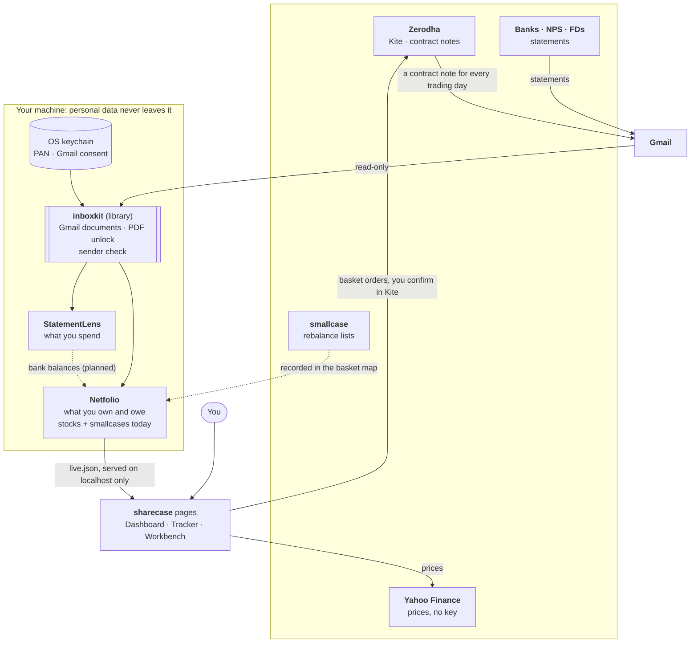
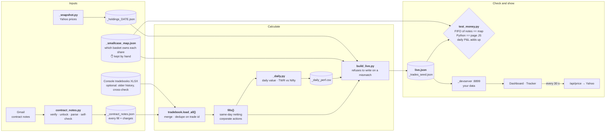
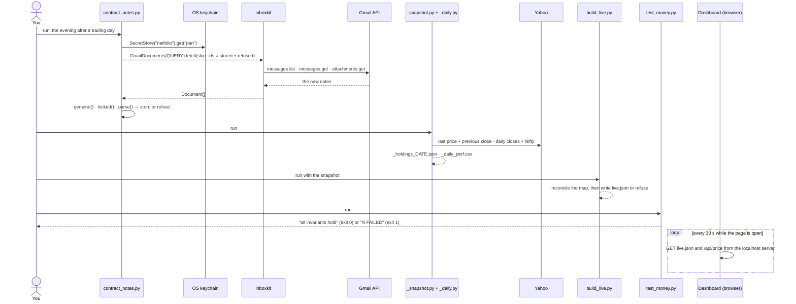
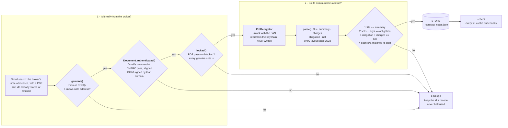
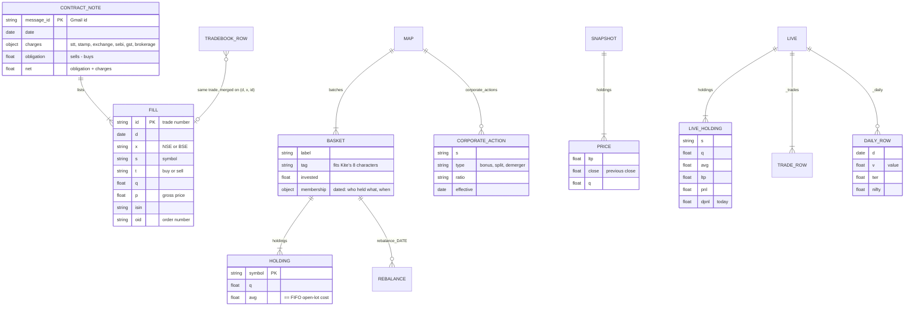

# How Netfolio works

Netfolio runs on your own machine. The code is public; your data sits next to it, git-ignored, and
never leaves the machine. One pipeline turns your broker's emails into a priced, reconciled
portfolio, and a test gate checks every number before you look at it.

## 1. Context

- **[inboxkit](https://github.com/udaysrinu/inboxkit)** finds the documents in Gmail, proves who sent
  them, and unlocks the PDFs. StatementLens uses the same library for bank statements.
- **[sharecase](https://github.com/udaysrinu/sharecase)** supplies the pages. Netfolio's local server
  feeds them your data; on the public site they only see files a visitor uploads.
- Gmail access is read-only and reuses a consent already in the keychain, so there is one Google login.

## 2. The pipeline

Run in this order (each step reads what the one before it wrote):

| # | Command | Does |
|---|---|---|
| 1 | `python3 contract_notes.py` | fetches new contract notes (from 45 days before the newest one stored; the whole mailbox on the first run) |
| 2 | `python3 _snapshot.py` | last price and previous close for every holding → `_holdings_<date>.json` |
| 3 | `python3 _daily.py` | daily value, P&L and time-weighted return against Nifty → `_daily_perf.csv` |
| 4 | `python3 build_live.py _holdings_<date>.json` | reconciles the map, embeds the daily curve → `live.json`, `_trades_seed.json` |
| 5 | `python3 test_money.py` | the gate: every invariant in section 5 |

`_daily.py` must run before `build_live.py`, which copies its output into `live.json`.

- **Trades** come from contract notes. Tradebook exports are optional: they fill in history older than
  the mailbox and serve as an independent check (`contract_notes.py --check`). Both are merged and
  deduped on (date, exchange, trade id), so overlaps are safe.
- **Which basket owns a trade** is the one step kept by hand. Kite's holdings and contract notes carry
  no basket, so rebalances are recorded in `_smallcase_map.json`, and the tests prove the map agrees
  with the broker's trades.

### One run, in order

## 3. Contract notes: trusting a PDF from your inbox

A broker must email a contract note for every day you trade, so the mailbox holds a complete trade
record whether or not your machine was on. Anyone can send an email that claims to be from the broker,
though, so a note is only used after it passes every gate below.

- **Sender.** The From address must be one of the broker's contract-note addresses. Each address is
  checked against its own signing domain, so trusting an old address doesn't loosen the new one.
- **Signature.** inboxkit reads Gmail's own `Authentication-Results` header: only the topmost one,
  and only from `mx.google.com`, because a sender can add fake ones below it. DMARC must pass with the
  From domain aligned, and DKIM must be signed by that domain. A header it can't parse fails closed.
- **Lock.** Every genuine note is locked with your PAN. The PAN is read from the OS keychain on each
  run and never written anywhere.
- **Sums.** A note is refused, never half-used, unless its own totals hold. Every layout change the
  broker has made was caught by these checks rather than producing wrong numbers.
- **Refusals** are stored with the reason, so a re-run doesn't spend Gmail quota downloading them
  again. `--retry-refused` tries them again after a parser fix.

## 4. How the numbers are calculated

| Number | Rule |
|---|---|
| Realised profit | FIFO per symbol with **same-day netting**, as Zerodha does it. On a day with both buys and sells, the matched quantity is intraday, at that day's average buy against its average sell. Only the remainder sells the oldest lots, or opens one new lot. |
| Corporate actions | bonuses, splits and demergers from the map adjust the trade list before FIFO (`adjusted_trades()`) |
| Average cost | the cost of the open FIFO lots. It equals Kite's average price, and a test proves it. |
| Uncosted | a sale whose buy isn't in the data is reported as uncosted, never as profit |
| Daily value | shares held at the close × that day's close; quantities are put on Yahoo's split-adjusted basis |
| Daily return | Modified Dietz: P&L ÷ (yesterday's value + half of today's net flow) |
| Time-weighted return | daily returns chained since the first trade, beside Nifty 50 over the same days |

Every figure is **gross**: contract notes record the charges (STT, stamp duty, exchange fees, GST),
but nothing subtracts them yet. Dividends aren't included either.

## 5. What is checked

`test_money.py` runs on your data and stops on the first broken invariant.

| Section | Invariant | Catches |
|---|---|---|
| 1. Trade list | no duplicate fills, ISO dates, positive quantities and prices, sorted | a double import, a bad parse |
| 2. FIFO | shares and cost are conserved per symbol; FIFO open lots == map holdings == Kite's average cost; every gap is a known corporate action | a lost or invented trade, a wrong cost basis |
| 3–4. Baskets | membership is dated; every realised rupee lands in exactly one basket | profit credited to the wrong basket, or counted twice |
| 5–6. Map and live.json | each basket's invested total matches its holdings; `live.json` quantities == the map | a stale or hand-edited map |
| 7. Parity | Python and the pages' own JavaScript (`parity.mjs`) agree to the rupee | the browser and the pipeline drifting apart |
| 8. Daily | daily P&L since the first trade == realised + change in unrealised | a missing price day, a bad split adjustment |
| 9. Hostile input | basket files and uploads can't become markup (`xss_test.mjs`) | script injection through a shared file |

`tests/run.py` runs the public tests on made-up trades; no data is needed.

## 6. Where things live

| What | Where |
|---|---|
| Code | this repo |
| Your data | git-ignored files beside the code: `_contract_notes.json`, `tradebook*.xlsx`, `_smallcase_map.json`, `_holdings_*.json`, `_daily_perf.csv`, `live.json`. The `.gitignore` is an allowlist, so a new data file is private by default. |
| Secrets | the OS keychain: the PAN (service `netfolio`, account `pan`) and the read-only Gmail consent |
| `_devserver.mjs` (:8899) | serves the sharecase pages with your data injected. Never use it for anything public. |
| `_cleanserver.mjs` (:8900) | the same pages with nothing of yours, for public screenshots |

### The data files

`_contract_notes.json` is keyed by Gmail message id. `_smallcase_map.json` holds the baskets plus the
account facts the code must not hardcode: symbol and price aliases, known quiet months, uncosted
allotments, corporate actions.

Both servers accept only `localhost` and `127.0.0.1` as the Host, so a web page can't reach them
through DNS rebinding.

## 7. Known limits

- **Basket attribution is by hand** (section 2).
- **The holdings check depends on the snapshot.** `build_live.py` compares the map with the
  snapshot's quantities. A Kite holdings snapshot makes that an independent check. The Yahoo snapshot
  from `_snapshot.py` takes its quantities from the map, so then the independent check is test 2,
  where FIFO over the broker's notes must equal the map.
- **Figures are gross** (section 4).
- **Yahoo is unofficial.** Prices that can't be observed are reported missing, never zero.
- **The pipeline runs when you run it.** A scheduled run after market close is planned.
